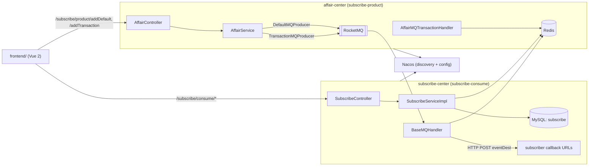

# ems

Event publish/subscribe over RocketMQ: a Spring Cloud Alibaba backend (`affair-center`, `subscribe-center`, shared `framework` module) plus a Vue 2 admin UI in `frontend/`. Application and UI text is Chinese; this document is English.

Solo project on the [Seal-Re](https://github.com/Seal-Re) account. MIT licensed.

## What it does

`affair-center` accepts a message that carries a list of events, groups the events by `eventType`, and publishes one RocketMQ message per event type (ordinary producer or transactional producer). `subscribe-center` consumes messages, keeps a rolling copy of the most recent ones in Redis, and forwards each message by HTTP POST to every callback URL subscribed to that event type. Subscriptions are stored in MySQL.

Naming note: there is no event CRUD here. `affair-center` never touches a database — it is a message publisher — and `subscribe-center` contains no "affair" code. "Affair" is the domain word for a business event.

## Architecture



## Services

| Module | `spring.application.name` | Port | Context path |
|---|---|---|---|
| `affair-center` | `subscribe-product` | 11452 | `/subscribe/product` |
| `subscribe-center` | `subscribe-consume` | 11451 | `/subscribe/consume` |
| `framework` | — | — | shared library, not runnable on its own |

`framework` is a plain Maven module imported by both services: the RocketMQ abstraction, Redis helpers, HTTP `RestTemplate` config, response wrappers and utilities.

## API

`affair-center` — request body is a `MessageEtt` (`method` + `params.events[]`; each event has `eventId`, `eventType`, `happenTime`, `srcIndex`, `srcName`, `srcParentIndex`, `srcType`, `status`, `timeout`, `data`):

| Method | Path | Behaviour |
|---|---|---|
| `POST` | `/subscribe/product/addDefault` | Publish each event via the ordinary `DefaultMQProducer` |
| `POST` | `/subscribe/product/addTransaction` | Publish each event via `TransactionMQProducer.sendMessageInTransaction` |

`subscribe-center`:

| Method | Path | Behaviour |
|---|---|---|
| `POST` | `/subscribe/consume/add` | Upsert subscription rows (`eventTypes[]` + `eventLvl[]` + `eventDest` + `subType`) |
| `POST` | `/subscribe/consume/delete` | Delete subscription rows for `eventTypes[]` + `eventDest` |
| `GET` | `/subscribe/consume/detect` | List all subscription rows |
| `GET` | `/subscribe/consume/getMsg?topic=&url=&N=` | Latest `N` messages for a topic, from Redis |
| `GET` | `/subscribe/consume/getLatestMsg` | Latest messages across all topics, from Redis |

## RocketMQ abstraction (`framework/`)

- `@EnableRocketmq` (declared but never applied — no application class carries it) would import `MQConfig`, which creates the `DefaultMQPushConsumer`, `DefaultMQProducer` and `TransactionMQProducer` beans, plus `MQTransactionListener` and two placeholder handlers.
- `@MQHandlerActualizer(topic=..., tags=...)` marks a handler; `MQListenerConcurrently` routes each consumed message to the handler whose topic/tag matches (`topic = "all"` matches everything), and `MQTransactionListener` does the same for transaction check callbacks.
- `DefaultMQHandler` / `DefaultMQTransactionHandler` are no-op placeholders (they return `null`) and are never selected because they carry no `@MQHandlerActualizer`.
- `@EnableDiscoveryClient` appears on `subscribe-center` only.
- Producer/consumer addresses, thread counts and subscribed topics are read from `rocketmq.producer.*` / `rocketmq.consumer.*` properties, with `127.0.0.1:9876` defaults.

## Transactional messages

`affair-center/src/main/java/com/seal/affair/mqHandler/AffairMQTransactionHandler.java` is the handler the framework's `MQTransactionListener` dispatches to (`@MQHandlerActualizer(topic = "all")`):

- `executeLocalTransaction` derives an id from the message (`MD5`), writes `rocketmq:transaction:<id> = COMMIT` to Redis with a 5-minute TTL, and returns `COMMIT_MESSAGE`.
- `checkLocalTransaction` returns `COMMIT_MESSAGE` if that Redis key still exists, otherwise `ROLLBACK_MESSAGE`.

The "local transaction" is therefore a Redis key with a TTL — no database write is involved.

## Configuration

Both services boot from Nacos (`src/main/resources/bootstrap.yml`): discovery and config server address `${app.nacos.server-addr}`, namespace `${app.env}`, config prefix equal to `spring.application.name`, plus `refreshable-dataids: app-subscribe.yml, app-redis.yml`. The placeholders `${app.profile}`, `${app.nacos.server-addr}`, `${app.env}` and `${app.nacos.ip}` are supplied by the root `pom.xml` profiles `portal` and `local`.

Because the datasource, Redis and RocketMQ settings are not in this repository, a Nacos instance is required, holding at least `subscribe-product.yml`, `subscribe-consume.yml`, `app-subscribe.yml` and `app-redis.yml`.

## Frontend (`frontend/`)

Vue 2.6 + Element UI 2.15 + vue-router 3 + axios, two views:

- `AffairView` — compose a `MessageEtt` (method, params, a repeatable list of events with a JSON `data` field) and send it with either "add default" or "transactional message".
- `SubscribeView` — add/delete subscriptions, list them, and read recent messages per topic from Redis.

Dev server runs on port 8080; `vue.config.js` and `nginx.conf` proxy `/subscribe/consume` and `/subscribe/product` to the two backend ports.

## Build and run

```bash
# backend (placeholders app.* come from a pom profile)
mvn -Plocal package
java -jar affair-center/target/affair-center-0.0.1-SNAPSHOT.jar
java -jar subscribe-center/target/subscribe-center-0.0.1-SNAPSHOT.jar

# frontend
cd frontend && npm install && npm run serve
```

Dockerfiles exist for `affair-center`, `subscribe-center` (`openjdk:11-jre-slim`) and `frontend` (`node:16` build stage + `nginx:alpine`). There is no docker-compose file; each service needs a Nacos, RocketMQ, MySQL and Redis instance reachable from its container.

## Limitations

- `/getMsg` accepts a `url` parameter that the implementation ignores.
- When `rocketmq.consumer.topics` is the default `*`, `MQConfig` calls `consumer.subscribe("*", "*")` — RocketMQ treats this as a literal topic named `*`, not a wildcard.
- `AffairMQHandler` (topic `affair`) acknowledges messages without processing them.
- No API gateway and no authentication: every endpoint is open.
- The consumer stores messages in Redis broadcast-only; subscriber delivery failures are logged, not retried.
- The only tests are the two generated `*ApplicationTest` context-load stubs; there is no CI configuration.

## License

MIT © [Seal-Re](https://github.com/Seal-Re)
